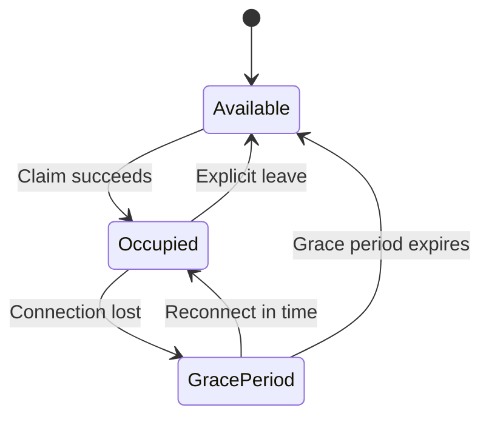

# Virtual Café — Codex Build Brief and Product Requirements

**Revision 4 · October 27, 2026**

## Instructions for Codex

Treat this document as the product source of truth for the Virtual Café MVP. Use it to understand the product and guide implementation; do not treat the entire document as a request to rewrite the whole application in one pass.

### How to work in the repository

1. **Inspect before editing.** Review the existing repository structure, package scripts, dependencies, current implementation, and environment-variable usage before proposing or changing files.
2. **Preserve working code.** Build on the existing architecture where reasonable. Do not replace files, dependencies, or configuration wholesale without a clear need.
3. **Plan in small, verifiable increments.** First report the current state, important gaps, and a short implementation plan. Then implement the smallest useful milestone and explain how to run or verify it.
4. **Follow the selected stack.** Use Next.js App Router, React, TypeScript, CSS Modules/global CSS variables, Supabase Auth, Supabase PostgreSQL, Supabase Realtime, and Vercel. Do not add Tailwind or another utility CSS framework.
5. **Keep secrets secure.** Never put Supabase service-role credentials or other secrets in client-side code, source control, or example values that look real. Use environment variables and document required variable names without exposing secret values.
6. **Make backend state authoritative.** Seat allocation, session ownership, and timer timestamps must not depend on client-side assumptions. Use database constraints and atomic backend operations for concurrent seat claims.
7. **Keep scope focused on the MVP.** Do not introduce unrequested features, a game engine, a separate WebSocket server, Redis, or unnecessary dependencies.
8. **State assumptions and blockers.** If a requirement is ambiguous or requires credentials, external setup, or a product decision, explain the blocker and choose a safe, minimal default only when reasonable.
9. **Verify changes.** Run relevant available checks (such as lint, type-check, build, or tests) when feasible. Report what was run and any failures; never claim a check passed if it was not run.
10. **Keep documentation current.** When setup, schema, environment variables, or workflows change, update the relevant README or concise setup notes.

### Recommended first response

Before making broad changes, summarize:

- What already exists in the repository and what appears to work.
- Which requirements are already implemented, missing, or blocked.
- The first small implementation milestone and the files likely to be involved.
- Any required environment variables or Supabase setup, without asking the user to reveal secret values.

Then proceed with the first milestone unless a genuine blocker requires a question.

---

# Product Requirements

The PRD is updated around five confirmed decisions: a **20-seat shared room**, automatic seat release following disconnection, fixed countdown sessions, publicly visible task names and timers, and a minimalist visual identity with distinctive custom avatars.

These decisions establish a clear product direction: a polished, shared digital workspace that prioritizes social accountability, low-friction focus sessions, and a recognizable visual style without unnecessary interface complexity.

## 1. Confirmed product decisions

| Decision | Final requirement |
|---|---|
| Room capacity | One shared room with 20 designated seats. |
| Seat release | Disconnecting users' seats are released automatically after a short grace period. |
| Timer behavior | Fixed-duration countdown; a new session is started after completion. |
| Task visibility | Task name, remaining time, and session status are visible to everyone in the room. |
| Art direction | Stylized minimalism, with clean layouts, distinctive avatars, restrained decoration, and a cohesive color palette. |

## 2. Updated functional requirements

### FR-02: Shared café environment

**Updated description:** Provide one shared café room with 20 designated seats and real-time occupancy synchronization.

Requirements:

- **FR-02.1:** The room contains exactly 20 predefined, individually identifiable seats.
- **FR-02.2:** Each seat has an available, occupied, or temporarily reserved state.
- **FR-02.3:** Users must claim an available seat before starting a work session.
- **FR-02.4:** Seat claims are validated atomically by the backend to prevent double occupancy.
- **FR-02.5:** All connected users see the same seat occupancy and associated avatar.
- **FR-02.6:** When all 20 seats are occupied or reserved, additional users receive a clear room-full message.
- **FR-02.7:** When a user disconnects unexpectedly, the system temporarily preserves their seat during a reconnection grace period.
- **FR-02.8:** If the user does not reconnect within the grace period, the seat is released and becomes available to others.
- **FR-02.9:** A user who reconnects within the grace period resumes their existing session when it remains valid.
- **FR-02.10:** Users can explicitly leave the room, releasing their seats immediately.

**Acceptance criteria**

- Two or more independent browser sessions see consistent room occupancy.
- No two users can successfully claim the same seat.
- The room never allocates more than 20 seats simultaneously.
- A user cannot start a session without a confirmed seat assignment.
- A disconnected user's seat becomes available after the configured grace period.
- A returning user can reclaim their existing seat during the grace period if it has not been invalidated.
- If the room is full, the application does not create a phantom seat or silently assign an occupied one.

### FR-03: Fixed work sessions and public task cards

**Updated description:** Users establish a fixed-duration task session, and the task remains publicly visible above their avatar for the duration of that session.

Requirements:

- **FR-03.1:** The task setup prompt appears after a successful seat claim.
- **FR-03.2:** A valid task name and duration are required to start a session.
- **FR-03.3:** The user chooses a duration from predefined options or a validated duration range.
- **FR-03.4:** Starting the session minimizes the setup prompt.
- **FR-03.5:** A compact task card appears above the user's avatar.
- **FR-03.6:** Every room occupant can see the task name, remaining time, and current session status.
- **FR-03.7:** The countdown uses an authoritative session end timestamp rather than relying on a browser interval as the source of truth.
- **FR-03.8:** The MVP does not support pausing or resuming a session. A user may end the session early or allow it to complete naturally.
- **FR-03.9:** When the timer reaches zero, the task card displays a completion state.
- **FR-03.10:** Users must explicitly start a new session to begin another timed task.
- **FR-03.11:** Ending or completing a task does not automatically release the seat; the user remains seated until leaving or disconnecting.
- **FR-03.12:** Task information is removed from the shared room when the session ends or is cancelled, subject to a brief completion indicator.

**Acceptance criteria**

- A user cannot start a session with an empty task name or invalid duration.
- The task card appears above the correct avatar and is visible to all connected occupants.
- Two different users see consistent remaining time, within reasonable network and rendering tolerances.
- Refreshing or reconnecting does not restart the countdown.
- Completed sessions do not restart automatically.
- A completed or cancelled task does not leave a stale active task card.
- Ending a task early updates the shared state and removes the active countdown.
- The seat remains occupied after normal task completion until the user leaves or disconnects.

### FR-04: Avatar identity and presentation

**Updated description:** Users select a predefined avatar from a cohesive, minimalist collection that provides recognizable identity without requiring extensive customization.

Requirements:

- **FR-04.1:** Users can select from a curated set of unique avatar faces.
- **FR-04.2:** Each avatar follows the same general illustration system, including consistent scale, visual weight, and rendering.
- **FR-04.3:** The selected avatar persists in the user's profile.
- **FR-04.4:** The selected avatar is displayed at a readable size in the room.
- **FR-04.5:** Avatar placement corresponds to the user's allocated seat.
- **FR-04.6:** Avatar selection must not require users to create or upload custom artwork for the MVP.

**Acceptance criteria**

- A user can preview and select an avatar before entering the café.
- The avatar remains consistent across visits and separate browser sessions.
- All 20 seat positions can accommodate avatars without systematically overlapping adjacent task cards.
- Missing avatar assets fall back to a default image without breaking room rendering.

### FR-05: Café ambience

The audio requirements remain unchanged, with additional emphasis on keeping audio controls unobtrusive.

- Ambient café audio loops while the café experience is active, subject to browser autoplay restrictions.
- Users can mute and restore audio without reloading the room.
- Audio controls remain accessible and visually consistent with the minimalist interface.
- Audio playback state is independent of other users joining, leaving, or starting tasks.

**Acceptance criteria:** Users can reliably mute and restore ambience, and browser restrictions produce a clear playback prompt rather than a broken or misleading control.

## 3. Updated visual design and art direction

### Design direction: Stylized minimalism

The application should feel like a thoughtfully designed digital café rather than a conventional productivity dashboard or a highly detailed simulation.

The visual identity should rely on **simple shapes, expressive character design, restrained decoration, and strong spatial composition**. Minimalism applies to the interface and visual treatment—not to the removal of personality.

### Café room

Use a clean, illustrated top-down or slightly angled room with clearly separated tables and seats. Keep decorative elements sparse so occupants remain the focal point.

### Avatar collection

Use simple, expressive faces with a consistent illustration style. Distinguish characters through hair, facial features, accessories, and color—not excessive detail.

### Task cards and controls

Use compact cards, readable typography, subtle borders, and restrained shadows. Reserve the strongest visual emphasis for the task name and remaining time.

### Visual requirements

- Use a consistent design-token system for colors, typography, spacing, borders, and radii.
- Maintain a clear distinction between the café environment, interactive seats, floating task cards, and room controls.
- Use subtle hover and selection states to communicate which seats are available and which are occupied.
- Avoid unnecessary panels, sidebars, charts, and productivity dashboards that compete with the shared room.
- Provide enough visual contrast for the 20 avatars and task cards to remain distinguishable.
- Keep animations optional and subtle; room occupancy and task status must not depend on animation alone.
- Reserve designated asset slots for future custom artwork without requiring final illustrations before the core room works.

### Updated room layout requirement

A 20-seat room must be designed for density from the beginning. The room should use a deliberate table arrangement rather than simply scaling up a smaller layout.

The layout must account for:

1. Twenty distinct seat hitboxes.
2. Consistent avatar placement at each seat.
3. Floating task cards that do not routinely obscure neighboring users.
4. Visible availability and occupancy states.
5. A persistent, unobtrusive audio control and room-capacity indicator.

If the room cannot display all task cards simultaneously without substantial overlap, the design should use compact cards and controlled positioning. The full task name and timer must still be accessible, for example through a click or focus interaction that expands the card.

## 4. Technology stack and technical architecture

### Selected technology stack

The MVP will use a TypeScript-based web stack with managed backend services to keep implementation and deployment convenient for a small team and an AI-assisted (vibe-coding) workflow.

| Layer | Selected technology | Purpose |
|---|---|---|
| Web framework | **Next.js (App Router) + React + TypeScript** | Build the user interface and server-side functionality in one application. TypeScript provides shared types and helps catch integration mistakes. |
| Styling | **CSS Modules + global CSS variables** | Create scoped component styles and reusable design tokens for colors, typography, spacing, borders, and radii. Do not introduce a utility CSS framework for the MVP. |
| Authentication | **Supabase Auth** | Handle sign-up, sign-in, sessions, and authenticated user identity. |
| Database | **Supabase PostgreSQL** | Persist profiles, seats, room state, and work sessions using relational data and constraints. |
| Real-time updates | **Supabase Realtime** | Broadcast database changes and track connected room participants. Use Presence for connection status, not as the sole source of persisted seat ownership. |
| Protected backend operations | **PostgreSQL functions/RPC and, where appropriate, Next.js Route Handlers or Server Actions** | Enforce atomic seat claims, validate session changes, and apply ownership checks. Keep privileged credentials on the server only. |
| Static assets | **Local assets in the Next.js `public/` directory** | Serve the initial avatar collection, room illustrations, icons, and ambient audio file. |
| Deployment | **Vercel** | Deploy the Next.js application and provide preview deployments for development branches. Supabase remains the hosted backend and database. |
| Version control | **Git + GitHub** | Track changes, review AI-generated code, collaborate, and revert regressions. |

### Implementation principles

- Prefer the built-in capabilities of Next.js and Supabase over introducing additional infrastructure.
- Use **CSS Modules** for component-specific styling and shared CSS custom properties for design tokens. Keep repeated values out of component stylesheets where practical.
- Use Supabase's publishable/client credentials in the browser only as intended, protect data with Row Level Security (RLS), and never expose the Supabase service-role key to the client.
- Perform sensitive mutations through a protected server-side operation or a carefully permissioned PostgreSQL function. Do not trust client-provided user IDs, seat availability, or timer status.
- Configure local development and Vercel environment variables separately. Do not commit `.env` files or secrets to Git.
- Keep the first implementation small: do not add a separate custom WebSocket server, Redis, a state-management library, or a game engine unless a demonstrated requirement calls for one.

### Client application

The Next.js client components are responsible for room rendering, seat selection, avatar display, task cards, countdown presentation, and audio controls. Use client-side interactivity only where needed; keep data access and privileged operations server-side.

### Real-time room service

Supabase Realtime is responsible for propagating relevant room changes and tracking active connections. The application must reconcile incoming events with authoritative database state and handle temporary disconnections or missed events without assuming the browser is always connected.

### Authoritative backend and database

Supabase PostgreSQL and protected server-side operations are responsible for seat claims, session timestamps, account ownership, and cleanup rules. Database constraints and atomic operations must prevent conflicting seat assignments. Vercel hosts the Next.js application; it is not the system of record for room state.

### Seat lifecycle

The backend should enforce a seat state machine such as:

Implementation requirements:

- Assign every seat a stable identifier.
- Enforce one active seat assignment per user per room.
- Use an atomic transaction or equivalent backend operation to claim a seat.
- Detect disconnections through the real-time service or a heartbeat mechanism.
- Use a configurable reconnection grace period; **30–60 seconds is a reasonable initial design choice**, subject to testing.
- Ensure that only the currently valid connection or session can renew a seat assignment.
- Make cleanup idempotent so duplicate disconnect events do not corrupt occupancy.

**Important distinction:** A network disconnect is not necessarily an intentional departure. The grace period helps prevent brief network interruptions from immediately removing a user. However, a seat should not remain occupied indefinitely if the browser closes or the connection disappears permanently.

### Fixed timer implementation

Store each active work session with at least:

- `started_at`
- `ends_at`
- `status`
- `user_id`
- `room_id`
- `seat_id`
- `task_name`

The remaining time should be derived from the session's end timestamp:

\[
\text{remaining time}=\max(0,\text{ends\_at}-\text{current time})
\]

The client may update the displayed countdown every second, but the authoritative timestamps and completion state must come from the backend.

This approach ensures that refreshing a page, reconnecting, or opening another browser does not restart the timer. The backend should also resolve expired sessions so a task can reach its completed state even if the original browser is no longer connected.

### Recommended data model adjustments

| Entity | Additional requirement |
|---|---|
| Room | Store a capacity of 20 and enforce it through the room's seat inventory. |
| Seat | Store the current occupant, occupancy status, and optional reservation expiration. |
| WorkSession | Store start/end timestamps and a lifecycle status such as `active`, `completed`, or `cancelled`. |
| Presence | Track active connections and last heartbeat separately from persistent user identity. |
| Profile | Store the selected avatar identifier and unique username. |

The seat assignment and presence models may be implemented using separate tables, a real-time service, or a combination. The critical requirement is that stale presence cannot permanently prevent seat reuse.

## 5. Updated non-functional requirements

| Area | Refined requirement |
|---|---|
| Capacity | Support 20 simultaneous seated users in the initial room. |
| Synchronization | Propagate seat, avatar, task, and timer state changes without requiring page refreshes. |
| Timer accuracy | Derive the countdown from authoritative timestamps, not accumulated client-side ticks. |
| Reconnection | Recover an existing valid session during the grace period and release abandoned seats afterward. |
| Readability | Display up to 20 occupied seats and associated task cards without making the room unusable. |
| Security | Enforce account ownership and seat allocation on the server. |
| Performance | Keep the room responsive with 20 occupants and active timers. |
| Accessibility | Support keyboard navigation, focus states, sufficient contrast, and accessible audio controls. |
| Maintainability | Separate room geometry and visual assets from seat and session logic. |

## 6. Updated success metrics and testing

The original success metrics remain relevant, but the multi-user tests should explicitly cover the full 20-seat configuration.

| Test | Passing condition |
|---|---|
| Full-room occupancy | All 20 seats can be claimed by 20 distinct users. |
| Capacity enforcement | A 21st user cannot claim an additional seat. |
| Concurrent seat claims | Simultaneous attempts cannot assign one seat to multiple users. |
| Disconnect cleanup | A disconnected user retains their seat during the grace period and loses it after expiration if they do not reconnect. |
| Reconnection | A user reconnecting within the grace period can recover their valid session. |
| Public task display | Every connected occupant can see each active task name, countdown, and status. |
| Timer persistence | Refreshing or reconnecting does not reset an active session. |
| Session completion | A finished timer transitions to completion without automatically starting another session. |
| Visual density | Twenty occupied seats remain recognizable and task information remains accessible. |
| Audio independence | Audio controls work regardless of room occupancy or session changes. |

For the initial demo, use separate browser profiles or devices to test concurrent users. Simulated users can help test the full room layout and load, but they do not replace real multi-client testing of authentication, seat allocation, and synchronization.

## 7. Revised implementation priorities

1. **Define the room and design system.** Establish the 20-seat layout, seat identifiers, color tokens, typography, and avatar asset specifications.
2. **Build the static room prototype.** Render all 20 seats and placeholder avatars. Validate visual density and task-card placement before completing the artwork.
3. **Implement authentication and seat allocation.** Add account persistence, atomic seat claims, room capacity enforcement, and explicit seat release.
4. **Implement presence and reconnection.** Add disconnect detection, a grace period, cleanup, and session recovery.
5. **Implement fixed work sessions.** Add task creation, authoritative timestamps, public task cards, cancellation, and completion.
6. **Add real-time synchronization.** Verify that occupancy and task states remain consistent across multiple browsers.
7. **Integrate ambience and visual polish.** Add the looping audio track, minimalist custom avatars, and subtle environmental details.
8. **Run full-room acceptance tests.** Test 20 occupants, capacity overflow, simultaneous seat claims, network interruptions, timer expiration, and readability.

## 8. Updated release criteria

The MVP is ready to demo when:

- The shared room supports 20 distinct seats and prevents over-allocation.
- Users can register, log in, and retain their username and avatar.
- Users can claim seats, start fixed-duration tasks, and leave the room.
- Task names, countdowns, and statuses are visible to all room occupants.
- Disconnecting users' seats are released according to the defined grace-period policy.
- Reconnecting users recover their session when eligible.
- Timers remain consistent across clients and never restart automatically.
- Café ambience works with clear mute/unmute controls.
- The minimalist visual design remains readable with all 20 seats occupied.
- The complete user journey works across separate browser sessions without manual state resets.

The most important design and engineering trade-off is now clear: **the application needs to feel visually simple while handling a genuinely shared, synchronized environment underneath.** Keeping the artwork modular and the session logic authoritative will make it possible to deliver a compelling demo without sacrificing reliability.
